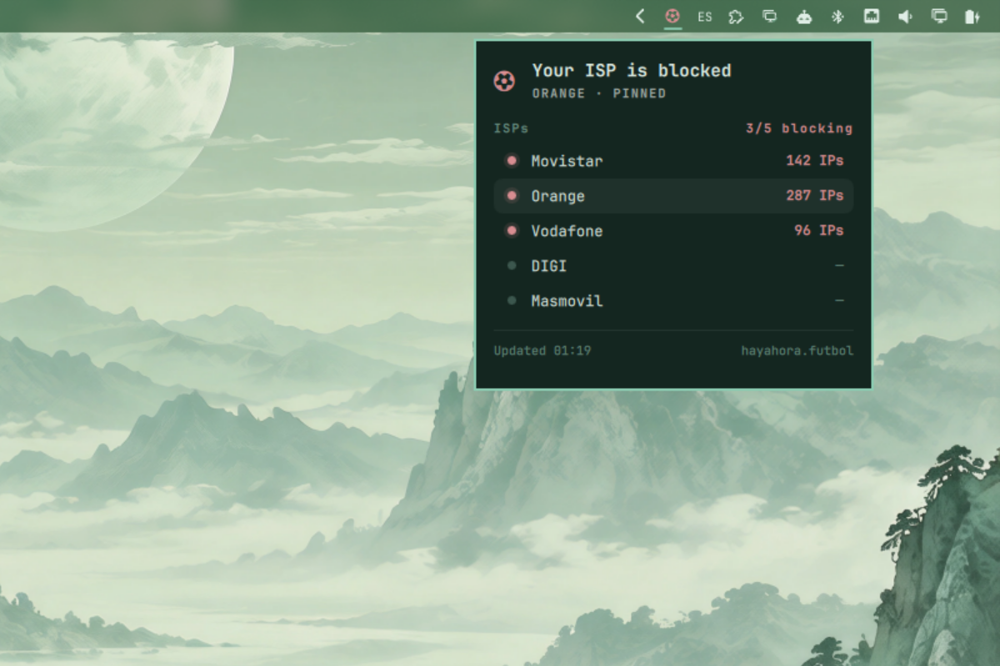

# LaLiga blocking — widget de barra para Omarchy

[English](README.md) | Español

Un plugin de shell para [Omarchy](https://omarchy.org) que te dice de un
vistazo si el bloqueo de IPs de LaLiga está activo en las operadoras
españolas, alimentado por las mediciones públicas de
[hayahora.futbol](https://hayahora.futbol).

Durante las retransmisiones de fútbol, las operadoras españolas bloquean
direcciones IP por orden judicial (sentencia 310/2024). Como las CDN
comparten infraestructura, esos bloqueos pueden tumbar sitios web que no
tienen nada que ver. Este widget muestra el estado en vivo directamente en
tu barra:

- **Un solo glifo de color** en la barra — oculto cuando nada se está
  bloqueando, blanco cuando solo bloquean otras operadoras, rojo cuando
  bloquean la tuya; `?` si no hay datos.
- **Tu operadora, no todas** — detectada automáticamente a partir de la org
  de tu IP pública (Vodafone, Movistar, Orange, DIGI, Masmovil; los MVNO se
  asignan a su red de origen), o fija una manualmente. Con una VPN, el
  widget pasa a vigilar la situación general, así que no te pierdes los
  apagones de los partidos.
- **Un panel con la foto completa** — todas las operadoras vigiladas, quién
  bloquea cuántas IPs, la última actualización del feed, y tu situación y el
  total general al pasar el ratón.

Los datos vienen de sondas comunitarias dentro de cada operadora española y
se refrescan cada 5 minutos (configurable) — deliberadamente conservador,
como pide hayahora.futbol.



*Estado de ejemplo en un escritorio Omarchy. El bloqueo de tu operadora pone la insignia en rojo, y el panel responde antes de listar la tabla.*

## Instalación

```sh
omarchy plugin add https://github.com/s-gato/omarchy-laligablocking-plugin.git --enable
```

Necesita `curl` (preinstalado en Omarchy). El widget aparece en la sección
derecha de la barra.

## Cómo leer el widget

La insignia es un único glifo de color — y desaparece cuando no pasa nada:

| Insignia | Significado |
|---|---|
| *(oculta)* | Nada por encima del suelo de ruido — el widget no se muestra |
| `⚽` blanco | Solo bloquean **otras** operadoras |
| `⚽` rojo | Bloquea **tu** operadora |
| `⚽ ?` gris | Sin datos, o tu operadora aún sin detectar |

**Suelo de ruido**: una operadora con 5 IPs bloqueadas o menos cuenta como
no bloqueando — los sitios colaterales aislados son ruido; un bloqueo de
partido son cientos. El mismo umbral gobierna el panel y el modo general
(con VPN, la pelota se pone roja solo cuando la mitad o más de las
operadoras vigiladas superan el umbral).

Al pasar el ratón ves las dos líneas a la vez: tu situación *y* el total
general («overall 2/5 ISPs blocking»). Un clic abre el panel: una respuesta
de una línea (tu operadora, o la situación general), la tabla completa por
operadora con tu fila localizada, y la última actualización del feed — en
tu hora local.


*Solo bloquean otras operadoras: la pelota sigue en blanco y el panel mantiene tu fila limpia.*

## Qué operadora se vigila: detección automática por defecto

El bloqueo lo aplica una operadora, así que el widget vigila **tu**
operadora, no todas:

- **`"isp": "auto"` (por defecto)** — al arrancar, el widget consulta la org
  de tu IP pública (ipinfo.io → ifconfig.co → ipapi.co; peticiones mínimas,
  3 reintentos, revisado cada 6 h) y la asigna a una de las operadoras
  vigiladas. La asignación es a nivel de red, así que los MVNO se resuelven
  a su red de origen (Pepephone/Yoigo/Lebara → Masmovil, Jazztel → Orange).
  Con una VPN o cualquier red no vigilada, el widget pasa al **modo
  general**: la pelota se pone roja cuando la mitad o más de las operadoras
  vigiladas están bloqueando — así sigues sabiendo cuándo hay apagón de
  partido.
- **`"isp": "Movistar"`** — fíjala manualmente: `Movistar`, `Orange`,
  `Vodafone`, `DIGI`, `Masmovil` (sin distinción de mayúsculas).
- **`"isp": "all"`** — acepta explícitamente la vista agregada de todas las
  operadoras vigiladas.

### Configuración

Los ajustes son claves en línea dentro de la entrada del widget en
`~/.config/omarchy/shell.json`:

```jsonc
"bar": {
  "layout": {
    "right": [ { "id": "sergio.laligablocking-plugin", "isp": "Movistar" } ]
  }
}
```

Las claves omitidas vuelven a `intervalSeconds: 300`, `isp: "auto"`. El
shell recarga `shell.json` en vivo; el plugin también se recarga
automáticamente si editas sus archivos.

- **Intervalo de sondeo** — 300 s por defecto. hayahora.futbol hace
  mediciones comunitarias y pide no hacer consultas innecesarias; por favor,
  mantén el intervalo en 120 s o más.

## Fuente de datos y límites

Los datos vienen de `https://hayahora.futbol/estado/data.json`, el feed
público de un grupo de voluntarios que mide los bloqueos desde conexiones
residenciales de las principales operadoras españolas. Sus mediciones tienen
límites: dependen de la red, del momento y de las IPs observadas. Un
resultado vacío no garantiza que un servicio sea accesible desde cualquier
conexión. Este plugin solo muestra sus datos; no salta nada y no está
afiliado a hayahora.futbol.

## Desinstalar

```sh
omarchy plugin remove sergio.laligablocking-plugin
```

### Migrar desde el id antiguo (`sergio.laliga-monitor`)

El id cambió para coincidir con el repositorio. En una instalación
existente:

```sh
omarchy plugin disable sergio.laliga-monitor
mv ~/.config/omarchy/plugins/sergio.laliga-monitor ~/.config/omarchy/plugins/sergio.laligablocking-plugin
omarchy plugin enable sergio.laligablocking-plugin
```

Después actualiza el `id` de tu entrada de barra en
`~/.config/omarchy/shell.json`
(`"id": "sergio.laligablocking-plugin"`) — tus ajustes `isp` e
`intervalSeconds` se conservan con la entrada.

## Desarrollo

- `Model.js` contiene todo el parseo del feed y la lógica de estado, sin
  dependencias, y está probado con Node: `node --test tests/model.test.mjs`.
- Tras editar cualquier archivo bajo `~/.config/omarchy/plugins/`, el shell
  se recarga automáticamente. Valida con `omarchy plugin validate <dir>` y
  revisa con `qmllint -I "$OMARCHY_PATH/shell" BarWidget.qml Panel.qml`.

## Licencia

MIT — ver [LICENSE](LICENSE).
