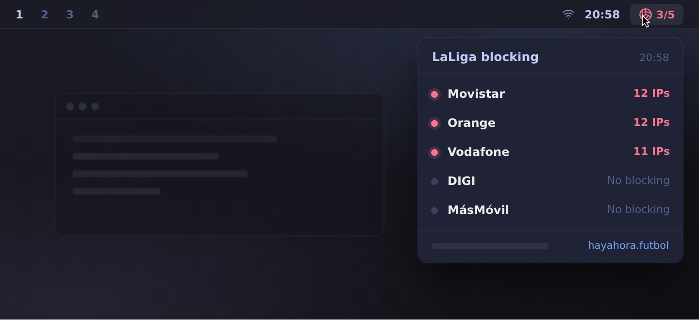

# LaLiga blocking — Omarchy bar widget

A third-party [Omarchy](https://omarchy.org) shell plugin that tells you at a
glance whether LaLiga's IP blocking is active on Spanish ISPs, powered by the
public measurements of [hayahora.futbol](https://hayahora.futbol).

During football broadcasts, Spanish ISPs block IP addresses under court order
(sentencia 310/2024). Because of shared CDN infrastructure, those blocks can
take down unrelated websites and services. This widget surfaces the live
status of those blocks right in your bar.



## Install

```sh
omarchy plugin add https://github.com/sergio/omarchy-laliga-plugin.git --enable
```

Or, from a local checkout:

```sh
omarchy plugin validate /path/to/omarchy-laliga-plugin
cp -r /path/to/omarchy-laliga-plugin ~/.config/omarchy/plugins/sergio.laliga-monitor
omarchy plugin enable sergio.laliga-monitor
```

The widget appears in the right section of the bar. `jq` is not required;
`curl` is (preinstalled on Omarchy).

## Reading the widget

| Badge | Meaning |
|---|---|
| `⚽ OK` (dimmed) | Your ISP is not being blocked right now |
| `⚽ 3 IPs` (urgent/red) | Your ISP is blocking — N IPs currently blocked |
| `⚽ 1/5`–`⚽ 3/5` (accent/urgent) | "all" mode: fraction of tracked ISPs blocking |
| `⚽ ?` (muted) | Data unavailable, or your ISP not yet detected (auto-detect retries 3×; pin one with `"isp"`) |

Click the widget for the panel: your ISP's row (blocked-IP count), the
tracking line (which ISP is watched and how it was chosen), and the overall
fraction across all tracked ISPs in the footer.

## Which ISP is tracked: auto-detected by default

A network is blocked by one ISP, so the widget watches **your** ISP, not all
of them:

- **`"isp": "auto"` (default)** — at startup the widget looks up the org of
  your public IP (ipinfo.io → ifconfig.co → ipapi.co; tiny requests, retried
  3×, re-checked every 6 h) and maps it to one of the tracked ISPs. The
  mapping is network-level, so MVNOs resolve to their host network
  (Pepephone/Yoigo/Lebara → Masmovil, Jazztel → Orange). If your network is
  not one of the five tracked ones, the badge answers `?` and the panel
  tells you — it never shows an aggregate you did not ask for.
- **`"isp": "Movistar"`** — pin it manually: `Movistar`, `Orange`,
  `Vodafone`, `DIGI`, `Masmovil` (case-insensitive).
- **`"isp": "all"`** — opt in to the aggregate view over every tracked ISP.

### Configure

Settings are inline keys on the widget's bar entry in
`~/.config/omarchy/shell.json`:

```jsonc
"bar": {
  "layout": {
    "right": [ { "id": "sergio.laliga-monitor", "isp": "Movistar" } ]
  }
}
```

Omitted keys fall back to `intervalSeconds: 300`, `isp: "auto"`. The shell
reloads `shell.json` live; the plugin also auto-reloads when you edit its
files.

- **Poll interval** — default 300 s. hayahora.futbol runs community
  measurements and asks users to avoid unnecessary queries; please keep the
  interval at 120 s or above.

## Data source and limits

Data comes from `https://hayahora.futbol/estado/data.json`, the public feed
of a volunteer group that measures the blocks from residential connections of
the major Spanish ISPs. Their measurements have limits: they depend on the
network, the moment, and the IPs observed. An empty result does not guarantee
a service is reachable from every connection. This plugin only displays their
data; it does not bypass anything and it is not affiliated with hayahora.futbol.

## Remove

```sh
omarchy plugin remove sergio.laliga-monitor
```

## Development

- `Model.js` holds all feed parsing and state logic, dependency-free, and is
  unit-tested with Node: `node --test tests/model.test.mjs`.
- `design/laliga-monitor/` holds the design mockup (stageshow) the QML
  implements, with rehearsal frames and notes.
- After editing any file under `~/.config/omarchy/plugins/`, the shell
  reloads automatically. Validate with `omarchy plugin validate <dir>` and
  lint with `qmllint -I "$OMARCHY_PATH/shell" BarWidget.qml Panel.qml`.

## License

MIT — see [LICENSE](LICENSE).
